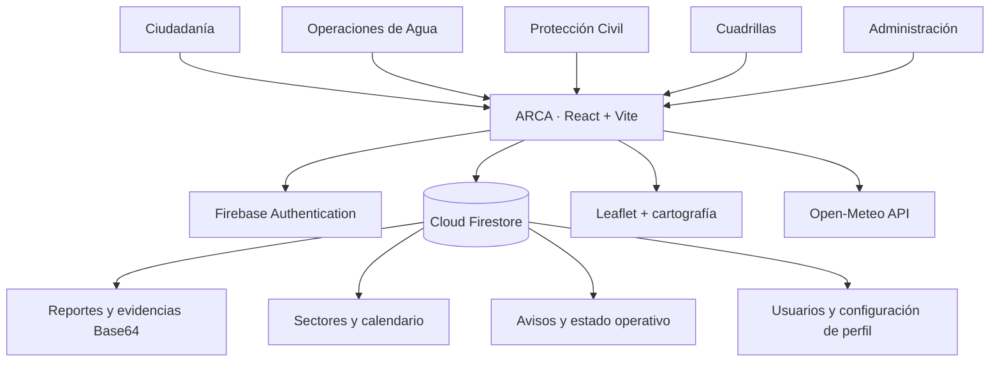
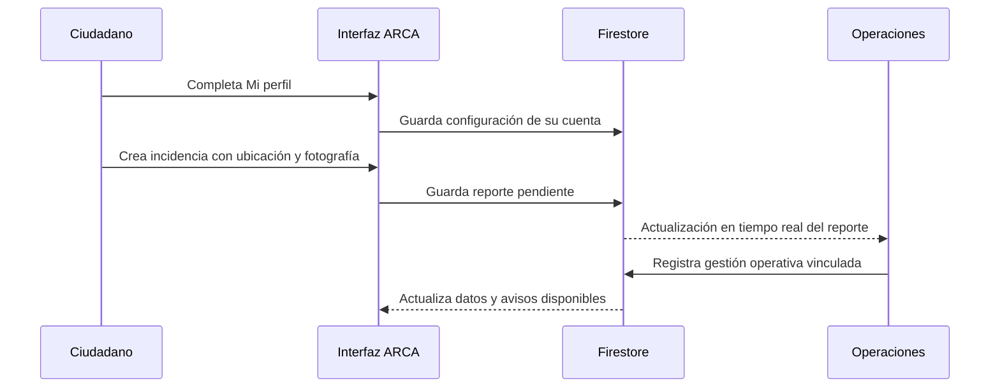

<div align="center">

# 🌊 ARCA

### Agua · Resiliencia · Clima Adaptativo

**HidroAlerta Veracruz | Veracruz – Boca del Río**

*Del reporte ciudadano a la acción preventiva.*

[](https://react.dev/)
[](https://vite.dev/)
[](https://firebase.google.com/)
[](https://open-meteo.com/)

**📍 Veracruz, México · 🖥️ Web responsive · 🌙 Tema claro/oscuro · 🔄 Datos en tiempo real**

[Características](#-qué-hace-arca) · [Tecnologías](#-tecnologías-y-para-qué-las-usamos) · [Instalación](#-cómo-ejecutarlo) · [Arquitectura](#-arquitectura) · [Estado](#-estado-del-proyecto)

</div>

---

## 💧 ¿Qué es ARCA?

**ARCA** es una plataforma web para conectar a la **ciudadanía**, el **Departamento de Operaciones de Agua**, **Protección Civil**, las **cuadrillas de mantenimiento** y la **administración** en torno a la gestión de incidencias hídricas, el calendario de tandeos y la comunicación de riesgos en Veracruz y Boca del Río.

En vez de mantener la información dispersa, ARCA busca que un reporte geolocalizado se convierta en una incidencia visible para el personal responsable y, eventualmente, en un aviso útil para la zona afectada.

> **Nuestra misión:** convertir datos, reportes y pronósticos en decisiones informadas y comunicación oportuna, sin confundir una alerta estimada con una medición oficial.

## ✨ Qué hace ARCA

| Función | ¿Para qué sirve? |
|---|---|
| 🗺️ **Mapa interactivo** | Ubicar incidencias ciudadanas y explorar reportes por tipo y localización. |
| 📸 **Reportes con evidencias** | Registrar inundaciones, encharcamientos, fugas, problemas de drenaje y otras incidencias con descripción, ubicación y fotografía. |
| 👤 **Mi perfil** | Configurar dirección, zona, código postal, teléfono, preferencias de alertas y fotografía de perfil. |
| ✅ **Validación de perfil** | Permitir consultar el mapa sin completar datos, pero exigir un perfil completo para crear reportes. |
| 📅 **Calendario de tandeos** | Mostrar por sector los días con suministro continuo, suministro parcial por horario, cortes y fechas sin programación publicada. |
| 🚰 **Gestión de sectores** | Registrar, editar, buscar y activar/desactivar sectores de distribución de agua. |
| 📢 **Avisos institucionales** | Preparar avisos de tandeo, seguimiento e incidencias asociados a sectores. |
| 🌦️ **Pronóstico meteorológico** | Consultar temperatura, precipitación y probabilidad de lluvia con Open-Meteo. |
| 📊 **Estadísticas** | Visualizar cifras obtenidas de los reportes y registros guardados. |
| 🌓 **Modo claro/oscuro** | Adaptar la interfaz a las preferencias visuales. |
| 📱 **Diseño responsive** | Usar el sistema desde computadora, tableta o celular. |

### 👥 Módulos y roles

| Módulo | Carpeta | Responsabilidad |
|---|---|---|
| **Administración** | `modules/admin/` | Administración de cuentas y acceso a funciones autorizadas. |
| **Ciudadanía** | `modules/citizen-reports/` | Reportar incidencias, consultar mapa, calendario personal y avisos. |
| **Operaciones de Agua** | `modules/water-operations/` | Gestionar sectores, tandeos, reportes operativos y publicaciones. |
| **Protección Civil** | `modules/civil-protection/` | Módulo destinado a la gestión de riesgos y alertas; integración progresiva. |
| **Cuadrillas** | `modules/maintenance-crew/` | Módulo destinado a recibir y atender trabajos; integración progresiva. |

El acceso se determina con **Firebase Authentication** y el perfil con rol almacenado en **Cloud Firestore**. Los módulos permanecen separados para facilitar el desarrollo en equipo.

---

## 🧰 Tecnologías y para qué las usamos

| Tecnología / herramienta | Uso en ARCA |
|---|---|
| **React** | Construcción de componentes reutilizables: tarjetas, formularios, dashboards, mapas, calendarios y modales. |
| **JavaScript + JSX** | Lógica de la aplicación, validación de formularios, estados de interfaz e integración entre componentes. |
| **Vite** | Servidor de desarrollo rápido y generación de la versión optimizada de producción. |
| **HTML5** | Estructura semántica y punto de entrada del sitio. |
| **CSS3** | Diseño visual, cuadrículas, temas claro/oscuro, animaciones y adaptación a móviles. |
| **Firebase Authentication** | Registro, inicio y cierre de sesión; identificación del usuario activo. |
| **Cloud Firestore** | Base de datos de usuarios, perfiles, reportes, sectores, calendarios y avisos; consultas y actualizaciones en tiempo real. |
| **Firebase Security Rules** | Control de lectura y escritura según identidad, rol, estructura y validación de datos. |
| **Firebase CLI** | Publicación de reglas y administración de la configuración del proyecto desde la terminal. |
| **Leaflet + React Leaflet** | Mapa interactivo, marcadores geográficos, selección de puntos y visualización de incidencias. |
| **OpenStreetMap (teselas)** | Cartografía de referencia utilizada en el mapa Leaflet, según la configuración del proveedor de teselas. |
| **Open-Meteo API** | Obtención de variables meteorológicas sin inventar lecturas de sensores. |
| **Geolocation API del navegador** | Solicitar la ubicación del ciudadano, con su consentimiento, al crear un reporte. |
| **Canvas API / WebP / Base64** | Reducir fotografías y almacenarlas directamente en documentos de Firestore, sin depender de Firebase Storage. |
| **Git** | Control de versiones y conservación del historial de cambios. |
| **GitHub** | Repositorio compartido, ramas, pull requests y colaboración del equipo. |
| **VS Code** | Edición, revisión y depuración del código. |
| **npm** | Instalación y administración de dependencias. |
| **Claude (integración prevista)** | Análisis asistido de estadísticas por medio de un endpoint de servidor; si no existe, se puede usar un resumen local. |

> **¿Por qué las fotografías se guardan en Base64?** Para el prototipo se comprimen a WebP y se almacenan en Firestore, ya que no se está utilizando un bucket de Firebase Storage. Esto exige imágenes pequeñas: **Firestore limita cada documento a 1 MiB** y Base64 incrementa el tamaño. No es la solución recomendada para una aplicación de imágenes a gran escala.

<details>
<summary><strong>🔎 ¿Qué aporta cada servicio de Firebase?</strong></summary>

- **Authentication:** comprueba quién inicia sesión; no guarda las incidencias.
- **Firestore:** almacena documentos y permite escuchar actualizaciones con consultas en tiempo real.
- **Security Rules:** protegen las operaciones de la base de datos; ocultar un botón en React **no sustituye** estos permisos.
- **Firebase CLI:** despliega cambios de configuración como las reglas de Firestore.
- **Firebase Storage:** **no se utiliza actualmente para evidencias**. Las fotografías comprimidas se guardan en Firestore.

</details>

---

## 🏗️ Arquitectura



### 📂 Estructura principal

```text
ARCA/
├── firebase/
│   └── rules/
│       └── firestore.rules      # Permisos y validaciones de Firestore
├── web/
│   ├── index.html
│   ├── package.json
│   └── src/
│       ├── app/
│       │   └── App.jsx          # Sesión, roles y navegación entre paneles
│       ├── modules/
│       │   ├── auth/            # Login, registro y perfil de acceso
│       │   ├── admin/
│       │   ├── citizen-reports/ # Mapa, reportes, perfil y tandeo ciudadano
│       │   ├── water-operations/# Gestión operativa de agua y tandeos
│       │   ├── civil-protection/
│       │   └── maintenance-crew/
│       └── styles/             # Estilos comunes de la aplicación
└── README.md
```

### 🗃️ Datos en Firestore

| Ruta / colección | Datos principales |
|---|---|
| `usuarios/{uid}` | Identidad, nombre, usuario y rol de la cuenta. |
| `usuarios/{uid}/configuracion/perfil` | Dirección, zona, sector, contacto, preferencias y foto de perfil. |
| `reportes/{id}` | Incidencia ciudadana, autor, tipo, ubicación, estado y evidencia. |
| `sectors/{id}` | Sectores de suministro, colonias y estado activo. |
| `schedule/{id}` | Programación por sector y fecha: continuo, parcial o corte. |
| `systemReports/{id}` | Reportes y flujo de atención de Operaciones/Protección Civil. |
| `notices/{id}` | Avisos institucionales por sector o de alcance general. |
| `sectorStatus/{id}` | Estado operativo de cada sector. |

> El **sector elegido en Mi perfil** se utiliza para relacionar al ciudadano con su calendario y avisos. La disponibilidad de datos depende de los permisos de Firestore y de que Operaciones haya publicado programación.

---

## 🚀 Cómo ejecutarlo

### Requisitos

- **Node.js y npm**, en versiones compatibles con la versión de Vite incluida en `web/package.json`.
- Acceso al proyecto Firebase correspondiente y credenciales de configuración web.
- Git, para clonar y colaborar.

### 1. Clonar el repositorio

```bash
git clone https://github.com/JuanECC/ARCA.git
cd ARCA/web
```

### 2. Instalar dependencias

```bash
npm install
```

### 3. Configurar el entorno

Crea el archivo `web/.env.local` con los valores **reales de tu proyecto Firebase**:

```dotenv
VITE_FIREBASE_API_KEY=tu_api_key_web
VITE_FIREBASE_AUTH_DOMAIN=tu_proyecto.firebaseapp.com
VITE_FIREBASE_PROJECT_ID=tu_project_id
VITE_FIREBASE_APP_ID=tu_app_id
```

No compartas contraseñas, claves de cuentas de servicio ni tokens privados. Las variables `VITE_` quedan disponibles en el código del navegador, por lo que **nunca deben contener secretos de servidor**. La seguridad depende de Authentication y de las reglas, no de esconder la configuración pública del SDK web.

### 4. Iniciar el servidor local

```bash
npm run dev
```

Abre la URL que muestre Vite en la terminal (habitualmente `http://localhost:5173`).

### 5. Generar la versión de producción

```bash
npm run build
```

La compilación se genera en `web/dist/`, salvo que la configuración de Vite indique otro destino.

<details>
<summary><strong>🔐 Despliegue de reglas de Firestore</strong></summary>

Desde la **raíz del repositorio**, y solo después de comparar las reglas con las publicadas por el equipo:

```bash
firebase deploy --only firestore:rules --project arca-e7c40
```

Este comando **reemplaza el conjunto de reglas publicado** por el contenido local. Coordinen los cambios antes de desplegar y no incluyan credenciales administrativas en GitHub.

</details>

<details>
<summary><strong>📍 ¿Por qué no funciona el GPS en algunos teléfonos?</strong></summary>

La Geolocation API requiere permiso del usuario y un contexto seguro (**HTTPS** o `localhost`). En computadoras la precisión puede variar; el usuario debe poder comprobar el punto o seleccionarlo manualmente.

</details>

---

## 🔄 Flujo de un reporte



El sistema conserva el reporte ciudadano original. La gestión de cuadrillas y los cambios automáticos de estado entre módulos se están integrando progresivamente.

---

## 📌 Estado del proyecto

| Componente | Estado |
|---|---|
| Inicio de sesión y roles | ✅ Implementado |
| Reportes ciudadanos con ubicación y fotografías comprimidas | ✅ Implementado |
| Perfil ciudadano y validación previa a reportar | ✅ Implementado |
| Mapa y filtros de incidencias | ✅ Implementado |
| Consulta del clima mediante Open-Meteo | ✅ Implementado |
| Calendario ciudadano por sector | ✅ Implementado |
| Gestión de sectores y programación en Operaciones | ✅ Implementado |
| Lectura de datos y avisos en tiempo real en la aplicación | 🟡 En integración y pruebas entre módulos |
| Flujo completo de cuadrillas y Protección Civil | 🚧 Pendiente de completar |
| Notificaciones push con la aplicación cerrada | 🚧 Pendiente |
| Envío real de SMS / WhatsApp | 🚧 Pendiente |
| Endpoint de análisis con IA en producción | 🚧 Pendiente |

**Nota:** los avisos *dentro* de la aplicación no equivalen a notificaciones push del sistema operativo. Tampoco las preferencias de alertas implican que ya exista un servicio de SMS o WhatsApp.

## 🧭 Próximos pasos

- Completar la integración entre reportes ciudadanos, Operaciones, Protección Civil y cuadrillas.
- Afinar la segmentación de avisos y calendarios por colonia y sector.
- Incorporar notificaciones push con permisos, service worker y emisor seguro.
- Reforzar permisos, pruebas y privacidad de información personal y geolocalización.
- Desplegar el endpoint de análisis con IA en un servidor seguro, si el equipo decide utilizarlo.
- Añadir pruebas automatizadas, capturas y documentación técnica del proyecto.

## 🤝 Colaboración con Git y GitHub

Para trabajar sin sobrescribir los avances de otros integrantes:

```bash
# Crear una rama para una funcionalidad
git switch -c feat/mi-funcionalidad

# Registrar cambios
git add .
git commit -m "feat: describir la funcionalidad"

# Publicar tu rama
git push -u origin feat/mi-funcionalidad
```

Después se abre un **Pull Request** hacia `main`. Antes de fusionarlo, revisar los archivos afectados, posibles conflictos y que el proyecto compile.

**Convención sugerida:** `feat:` funcionalidad nueva · `fix:` corrección · `style:` ajustes visuales · `docs:` documentación · `refactor:` reorganización interna.

---

## 🔒 Privacidad y seguridad

ARCA puede procesar **datos de ubicación, contacto y fotografías**. El acceso debe limitarse según el rol y la finalidad. Las reglas de Firestore son una parte esencial de la seguridad; además se requiere una política de privacidad antes de un uso público real.

Las fotografías Base64 consumen almacenamiento y ancho de banda de Firestore. La interfaz debe indicar cuándo un día **no tiene programación publicada** en lugar de asumir que hay suministro o corte. Los resultados meteorológicos tampoco equivalen por sí solos a una alerta oficial de riesgo.

---

<div align="center">

### 🌊 ARCA — Tecnología para cuidar el agua y conectar a las personas

**Veracruz · Boca del Río · México**

*Del reporte ciudadano a la acción preventiva.*

[⬆ Volver al inicio](#-arca)

</div>
