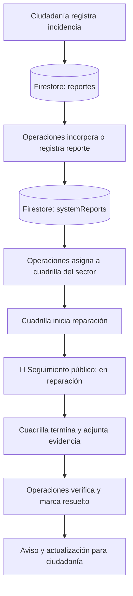
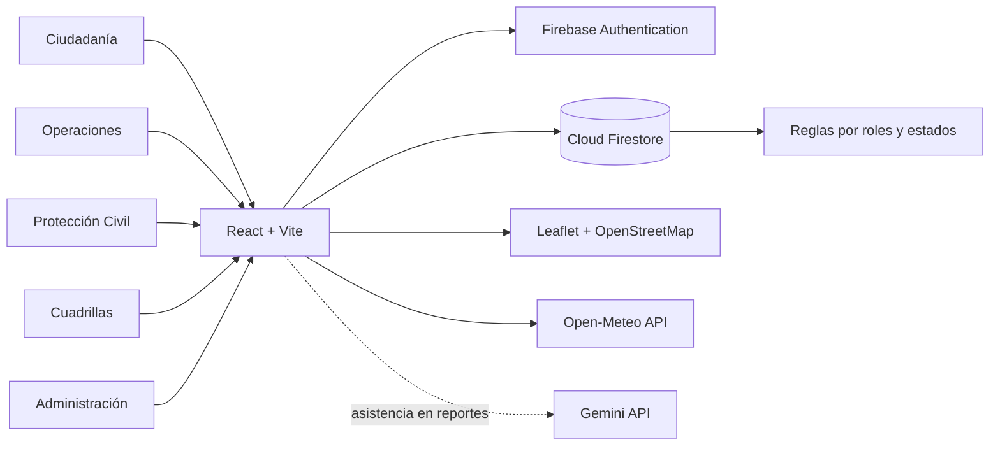

<div align="center">

# 🌊 ARCA

### Agua · Resiliencia · Clima Adaptativo

**HidroAlerta Veracruz | Veracruz – Boca del Río, México**

*Del reporte ciudadano a la acción preventiva.*

[](https://react.dev/)
[](https://vite.dev/)
[](https://firebase.google.com/)
[](https://ai.google.dev/)
[](https://open-meteo.com/)

**🖥️ Aplicación web responsive · 🌓 Tema claro/oscuro · 🔄 Firestore en tiempo real · 🗺️ Geolocalización**

[Descripción](#-qué-es-arca) · [Módulos](#-módulos-y-roles) · [Tecnologías](#-tecnologías-utilizadas) · [Arquitectura](#-arquitectura-y-datos) · [Bitácora](#-bitácora-de-desarrollo) · [Instalación](#-instalación-y-ejecución) · [Estado](#-estado-actual-del-proyecto)

</div>

---

## 💧 ¿Qué es ARCA?

**ARCA (Agua · Resiliencia · Clima Adaptativo)** es una plataforma web orientada a la gestión y comunicación de incidencias relacionadas con el agua y los riesgos hidrometeorológicos en **Veracruz y Boca del Río**. Integra cinco perfiles de trabajo: **ciudadanía, Operaciones de Agua, Protección Civil, cuadrillas de mantenimiento y administración**.

Su propósito es conectar el reporte de un problema con una atención institucional rastreable: registrar la incidencia, ubicarla geográficamente, asignar responsables, mostrar avances y comunicar su resolución. El sistema complementa ese flujo con pronósticos meteorológicos, programación del suministro de agua y herramientas de inteligencia artificial para facilitar la redacción de reportes.

> **Misión:** transformar información ciudadana, registros operativos y datos meteorológicos en acciones coordinadas y avisos oportunos. Los pronósticos y los textos generados con IA son herramientas de apoyo, no sustituyen la verificación ni las decisiones de las autoridades responsables.

## 🎯 Objetivos

- **Centralizar** reportes ciudadanos e institucionales, con evidencia fotográfica y ubicación.
- **Coordinar** la atención de incidencias mediante sectores, responsables y cuadrillas.
- **Mantener informada** a la ciudadanía sobre tandeos, reparaciones y alertas relevantes.
- **Facilitar** la elaboración de reportes mediante inteligencia artificial generativa, con revisión humana.
- **Conservar trazabilidad** del proceso de atención y distinguir entre un trabajo iniciado, terminado y resuelto.

## ✨ Funcionalidades principales

| Funcionalidad | Descripción |
|---|---|
| 🗺️ Mapa interactivo | Visualización de incidencias y alertas georreferenciadas mediante Leaflet. |
| 📸 Reportes con evidencia | Registro de fugas, drenaje, inundaciones, encharcamientos y otros eventos; fotografía comprimida y ubicación. |
| 🤖 Reportes asistidos con Gemini | Integración de una API de Gemini para apoyar la generación/redacción de reportes con IA; el contenido debe revisarse antes de usarse oficialmente. |
| 👤 Perfil ciudadano | Dirección, zona, código postal, teléfono, sector y preferencias de alertas. |
| 📅 Calendario de tandeos | Programación por sector: suministro continuo, parcial, corte o ausencia de programación. |
| 🚰 Gestión de sectores | Alta, edición y activación/desactivación de sectores de distribución. |
| 🌦️ Información meteorológica | Consulta de variables de pronóstico a través de Open-Meteo. |
| 📢 Avisos institucionales | Publicaciones de Operaciones y alertas de Protección Civil, con permisos diferenciados. |
| 🚨 Riesgos de Protección Civil | Creación, publicación, control y retiro de alertas; indicador rojo para alerta activa y verde para riesgo controlado. |
| 👷 Seguimiento de cuadrillas | Asignación por sector, inicio de reparación, registro de responsable y evidencia de terminación; integración transversal en pruebas. |
| 📊 Paneles y actividad | Información y estadísticas derivadas de registros de Firestore, de acuerdo con el rol. |
| 🔐 Acceso por rol | Sesión en Firebase Authentication, perfiles y autorización por reglas de Firestore. |
| 📱 Experiencia adaptable | Interfaces responsive y temas claro/oscuro. |

## 👥 Módulos y roles

| Rol | Carpeta | Responsabilidad |
|---|---|---|
| **Administración** | `web/src/modules/admin/` | Gestión administrativa y acceso a funciones autorizadas. |
| **Ciudadanía** | `web/src/modules/citizen-reports/` | Registrar incidencias, consultar mapas, avisos, perfil y calendario de tandeo. |
| **Operaciones de Agua** | `web/src/modules/water-operations/` | Gestionar sectores, calendarización, reportes, asignación de mantenimientos y avisos de restablecimiento. |
| **Protección Civil** | `web/src/modules/civil-protection/` | Registrar riesgos, publicar alertas, marcarlas como controladas y retirar avisos sin borrar el historial institucional. |
| **Cuadrillas** | `web/src/modules/maintenance-crew/` | Consultar trabajos asignados, gestionar integrantes por sector e informar inicio y terminación con evidencia. |

### Ciclo de atención de reportes



> El reporte original del ciudadano se conserva en `reportes`. Su gestión institucional se registra por separado en `systemReports`; `workUpdates` presenta un estado público mínimo de mantenimiento. **La visualización del estado en todas las tarjetas ciudadanas requiere verificar la vinculación entre registros.**

### Ciclo de alertas de Protección Civil

1. **Nuevo riesgo:** se crea el reporte interno en `systemReports`.
2. **Publicado:** se genera el aviso ciudadano correspondiente en `notices` y el marcador se muestra **rojo**.
3. **Controlado:** se registra el cierre en el reporte y `notices.estado = 'controlado'`; el marcador pasa a **verde**.
4. **Publicación retirada:** se elimina el aviso de `notices`, desaparece del mapa y **se conserva** el historial en `systemReports` mediante `publicationRetired`.

Este flujo rojo → verde → retirado se comprobó durante las pruebas funcionales descritas en el desarrollo del proyecto.

## 🧰 Tecnologías utilizadas

| Tecnología / herramienta | Uso en ARCA |
|---|---|
| **React** | Interfaces basadas en componentes, formularios, paneles, modales y vistas reactivas. |
| **JavaScript y JSX** | Lógica de negocio, estados, validaciones e integración entre módulos. |
| **Vite** | Entorno de desarrollo y compilación optimizada de la aplicación. |
| **HTML5** | Documento base y estructura semántica. |
| **CSS3** | Diseño responsive, animaciones, estilo visual y temas claro/oscuro. |
| **Node.js y npm** | Entorno de desarrollo, instalación de dependencias y scripts. |
| **Firebase Authentication** | Autenticación, identificación de sesiones y usuarios institucionales. |
| **Cloud Firestore** | Almacenamiento documental y actualización en tiempo real mediante listeners. |
| **Firebase Security Rules** | Restricciones por identidad, rol, transición de estados y validación de documentos. |
| **Firebase CLI** | Comprobación y despliegue de configuración/reglas del proyecto Firebase. |
| **Leaflet y React Leaflet** | Mapas interactivos, selección geográfica, marcadores y ventanas informativas. |
| **OpenStreetMap** | Cartografía de referencia mediante teselas. |
| **Geolocation API** | Solicitud opcional de ubicación desde el navegador, sujeta al permiso del usuario. |
| **Open-Meteo API** | Pronóstico de temperatura, precipitaciones y probabilidad de lluvia. |
| **Gemini API (Google)** | Generación asistida por IA de contenido para reportes; requiere revisión y controles de uso. |
| **Canvas API, WebP/JPEG y Base64** | Compresión y codificación de evidencias para su almacenamiento en Firestore dentro de los límites definidos. |
| **Git** | Historial de cambios y control de versiones. |
| **GitHub** | Repositorio y colaboración del equipo. |
| **Visual Studio Code** | Desarrollo, depuración, edición y manejo de Git. |

**Sobre Gemini:** la integración de la API para creación de reportes con IA fue indicada por el equipo. En el material proporcionado no se especifican el **modelo exacto**, el **SDK**, el **endpoint**, el **prompt** ni el método de custodia de credenciales; por ello no se atribuye una implementación concreta que no haya sido verificada. Para uso público debe mantenerse la clave fuera del código cliente y controlar el acceso desde un backend o proxy seguro.

**Sobre las evidencias:** en el prototipo se han utilizado fotografías comprimidas y codificadas en Base64 dentro de Firestore, sin depender de Firebase Storage. Esto facilita la primera integración, pero eleva el tamaño de documentos y no es la estrategia ideal a gran escala; Firestore limita cada documento a **1 MiB**.

## 🏗️ Arquitectura y datos



La interfaz consulta Firestore y recibe actualizaciones mediante `onSnapshot`; los permisos efectivos se definen en las reglas del servidor, no solamente ocultando opciones del frontend. Las operaciones relacionadas se agrupan con `writeBatch` cuando deben producirse conjuntamente (por ejemplo, publicar o retirar alertas y sincronizar documentos).

### Estructura principal del repositorio

```text
ARCA/
├── firebase/
│   └── rules/
│       └── firestore.rules
├── web/
│   ├── index.html
│   ├── package.json
│   └── src/
│       ├── app/
│       │   └── App.jsx
│       ├── modules/
│       │   ├── auth/
│       │   ├── admin/
│       │   ├── citizen-reports/
│       │   ├── water-operations/
│       │   ├── civil-protection/
│       │   └── maintenance-crew/
│       └── styles/
└── README.md
```

### Colecciones principales de Firestore

| Colección / ruta | Información almacenada |
|---|---|
| `usuarios/{uid}` | Datos de identidad institucional, perfil y rol. |
| `usuarios/{uid}/configuracion/perfil` | Información adicional del perfil ciudadano. |
| `reportes/{id}` | Incidencias ciudadanas, evidencia, localización y estado de origen. |
| `sectors/{id}` | Sectores de suministro y colonias asociadas. |
| `schedule/{id}` | Tandeos programados por sector y fecha. |
| `systemReports/{id}` | Reportes institucionales, asignaciones, cierre y resolución. |
| `notices/{id}` | Avisos de Operaciones y alertas de Protección Civil mostrados a la ciudadanía. |
| `sectorStatus/{id}` | Estado general del sector (`normal` / `reparacion`). |
| `sectorCrews/{sectorId}` | Integrantes registrados en una cuadrilla por sector, según la integración propuesta. |
| `workUpdates/{reportId}` | Estado público de trabajos (`asignado`, `en-proceso`, `terminado`, `resuelto`). |
| `pcUnits/{id}` | Unidades operativas registradas por Protección Civil. |

> **Trazabilidad:** no se debe borrar el reporte institucional cuando se retira un aviso público. Los estados `terminado` (cuadrilla) y `resuelto` (Operaciones) representan etapas diferentes.

## 📔 Bitácora de desarrollo

La siguiente bitácora reúne las etapas funcionales conocidas del proyecto. **Se organiza por fases y no por fechas**, porque el material proporcionado no documenta la fecha exacta de cada implementación. Su estado refleja lo observado o comunicado durante el desarrollo, no una auditoría de producción.

| Fase | Trabajo realizado | Resultado / aprendizaje |
|---|---|---|
| **1. Planteamiento** | Definición del problema hídrico, usuarios involucrados y alcance Veracruz–Boca del Río. | Propuesta de plataforma con reportes, prevención, tandeo y atención institucional. |
| **2. Base frontend** | Estructura React/Vite, estilos CSS, navegación y adaptación a escritorio y móvil. | Interfaz modular, responsive y con tema claro/oscuro. |
| **3. Usuarios y seguridad** | Integración de Firebase Authentication, perfiles en Firestore y reglas por rol. | Sesiones separadas para ciudadanía, Operaciones, Protección Civil, Cuadrillas y administración. |
| **4. Reportes ciudadanos** | Formularios, geolocalización, evidencia comprimida, persistencia y mapa Leaflet. | Reportes visibles y almacenamiento en tiempo real. |
| **5. Abastecimiento** | Administración de sectores, calendario de tandeo, estados y avisos institucionales. | Consulta de programación según sector y comunicaciones de Operaciones. |
| **6. Meteorología** | Consulta de datos de pronóstico mediante Open-Meteo. | Información complementaria para la toma de decisiones, sin presentarla como medición oficial. |
| **7. Reportes con IA** | Incorporación de la API de Gemini para asistir en la creación/redacción de reportes. | Apoyo generativo; pendiente documentar el modelo, controles y arquitectura exacta. |
| **8. Protección Civil** | Reportes de riesgo, publicación a `notices`, control y retiro mediante lotes de Firestore. | Se corrigió la sincronización del marcador **rojo → verde → retirado** y se probó el flujo. |
| **9. Depuración de permisos** | Comparación de UID, `usuarios/{uid}`, roles fijos y reglas Firestore. | Identificada incompatibilidad entre el UID de Authentication y el ID de perfil de la cuenta de mantenimiento. |
| **10. Cuadrillas** | Adaptación de una interfaz con datos de demostración hacia `systemReports`, `sectorCrews` y `workUpdates`. | Integración preparada de asignación, inicio, evidencia y resolución; requiere prueba funcional de punta a punta. |
| **11. Integración ciudadana** | Preparación de marcadores públicos 👷 para trabajos `en-proceso`. | Se definió la representación visual del mantenimiento sin exponer reportes privados. |
| **12. Documentación y control de versiones** | Revisión de reglas, estructura de carpetas, comandos de compilación, uso de Git/GitHub y README. | Base documental para mantenimiento, colaboración y futuras pruebas. |

### Incidencias técnicas relevantes y cómo se abordaron

- **Alertas de Protección Civil que no desaparecían:** se detectó la necesidad de vincular `systemReports` y `notices` mediante `reportId` y sincronizar `estado`, `closure` y `publicationRetired` con reglas coherentes.
- **Marcador de riesgo que seguía rojo:** se verificó que la vista ciudadana ya contemplaba el color verde; el problema estaba en la actualización del documento público de Firestore.
- **Acceso a Cuadrillas rechazado:** el UID autenticado y la ubicación del perfil en `usuarios` no coincidían; se definió la corrección del perfil y de los identificadores autorizados por las reglas.
- **Cuadrillas con información simulada:** se identificó el uso de datos locales de demostración y se propuso llevar las acciones a Firestore para preservar los estados entre sesiones.
- **Riesgo de romper módulos con cambios en reglas:** se optó por mantener las reglas existentes y añadir únicamente los permisos necesarios en lugar de sustituirlas por una versión resumida sin equivalencia comprobada.

## 🚀 Instalación y ejecución

### Requisitos

- Node.js y npm en versiones compatibles con `web/package.json`.
- Git y acceso al repositorio.
- Proyecto Firebase configurado y acceso autorizado a sus servicios.

### 1. Clonar el proyecto

```bash
git clone https://github.com/JuanECC/ARCA.git
cd ARCA/web
```

### 2. Instalar dependencias

```bash
npm install
```

### 3. Configurar Firebase

Crea `web/.env.local` con los datos de configuración web del proyecto:

```dotenv
VITE_FIREBASE_API_KEY=tu_api_key_web
VITE_FIREBASE_AUTH_DOMAIN=tu_proyecto.firebaseapp.com
VITE_FIREBASE_PROJECT_ID=tu_project_id
VITE_FIREBASE_APP_ID=tu_app_id
```

> Los nombres anteriores corresponden a la estructura del README base. Verifica las variables que realmente lee `web/src/modules/auth/firebase.js`. **No agregues una clave privada de Gemini usando `VITE_`**, porque esas variables quedan expuestas en el navegador. Una integración segura de IA debe usar un servicio de backend con credenciales protegidas.

### 4. Ejecutar en desarrollo

```bash
npm run dev
```

Vite mostrará la dirección local de la aplicación (frecuentemente `http://localhost:5173`).

### 5. Construir para producción

```bash
npm run build
```

La salida suele generarse en `web/dist/`, según la configuración del proyecto.

### 6. Desplegar reglas de Firestore (solo personal autorizado)

Desde la raíz donde esté `firebase.json`, después de revisar y probar las reglas:

```bash
firebase deploy --only firestore:rules --project arca-e7c40
```

**Advertencia:** este comando reemplaza las reglas publicadas. No se debe ejecutar sin comparar los cambios locales y verificar permisos con el emulador.

## 🧪 Pruebas funcionales sugeridas

| Prueba | Resultado esperado | Situación conocida |
|---|---|---|
| Inicio de sesión según rol | Redirige al módulo permitido. | Base implementada; revisar UID/perfil de Cuadrillas. |
| Crear reporte ciudadano | Persiste en `reportes` con ubicación y evidencia. | Funcionalidad reportada en el README base. |
| Mostrar clima y tandeo | Consulta el pronóstico y la programación del sector. | Funcionalidad reportada en el README base. |
| Publicar alerta de Protección Civil | Aparece aviso y marcador rojo. | Flujo probado durante el desarrollo. |
| Marcar riesgo controlado | El aviso cambia a verde. | Flujo probado durante el desarrollo. |
| Retirar alerta controlada | Desaparece el aviso, se conserva historial. | Flujo probado durante el desarrollo. |
| Asignar trabajo desde Operaciones | Se crea `workUpdates` y cambia `systemReports`. | Por verificar en Firebase real. |
| Iniciar mantenimiento desde Cuadrillas | Estado `en-proceso` y marcador 👷 visible. | Por verificar de punta a punta. |
| Terminar y resolver | Se adjunta evidencia, se valida y se notifica. | Por verificar de punta a punta. |
| Generar texto mediante Gemini | Produce borrador pertinente para revisión. | Integración indicada por el equipo; faltan detalles técnicos de prueba. |

## 📌 Estado actual del proyecto

| Componente | Estado |
|---|---|
| Interfaz React y navegación por roles | ✅ Implementada |
| Reportes ciudadanos, perfil y mapa | ✅ Implementados según documentación base |
| Gestión de sectores y tandeos | ✅ Implementada según documentación base |
| Clima con Open-Meteo | ✅ Integrado según documentación base |
| Publicación, control y retiro de alertas de Protección Civil | ✅ Flujo comprobado |
| Asistencia con Gemini para creación de reportes | 🟡 Integración indicada; falta documentar detalles y validaciones |
| Cuadrillas y seguimiento público de reparaciones | 🟡 Integración en pruebas |
| Estado sincronizado en **todas** las tarjetas ciudadanas | 🟡 Pendiente de comprobar/completar |
| Notificaciones push con aplicación cerrada | 🚧 No confirmadas |
| Envío real de SMS/WhatsApp | 🚧 No confirmado |
| Pruebas automatizadas y auditoría de permisos | 🚧 Pendientes de documentar |

## 🔒 Seguridad, privacidad y buenas prácticas

- **Roles y reglas:** toda escritura en Firestore debe estar autorizada por Security Rules. Una restricción en la interfaz no basta.
- **Identidad consistente:** `Authentication UID`, ID de `usuarios/{uid}` y campo `uid` deben coincidir; las reglas que usan cuentas fijas deben mantenerse alineadas.
- **Información ciudadana:** ubicación, datos de contacto y fotografías requieren controles adecuados y una política de privacidad antes de uso público.
- **Inteligencia artificial:** no enviar datos personales innecesarios a Gemini; verificar y aprobar los textos generados. No almacenar claves privadas dentro de React ni en Git.
- **Geolocalización:** requiere autorización del usuario y, normalmente, contexto seguro (`HTTPS` o `localhost`).
- **Evidencias:** las imágenes Base64 deben mantenerse pequeñas; considerar Storage u otra solución apropiada si el volumen aumenta.
- **Estados coherentes:** separar `asignado`, `en-proceso`, `terminado` y `resuelto`. Evitar marcar un trabajo como resuelto antes de la validación de Operaciones.
- **Alertas oficiales:** los datos meteorológicos y el texto producido por IA no deben presentarse automáticamente como comunicados oficiales.

## 🧭 Próximos pasos

1. Completar y validar con varias cuentas el ciclo de **Operaciones → Cuadrillas → Ciudadanía → Operaciones**.
2. Relacionar explícitamente los estados de `workUpdates` con las tarjetas de reportes ciudadanos.
3. Probar reglas de Firestore en el emulador, especialmente transiciones por lotes y casos de permisos insuficientes.
4. Documentar la implementación efectiva de Gemini (modelo utilizado, ubicación de la integración, validación de salidas y custodia de credenciales).
5. Definir métricas verificables: reportes recibidos, tiempos de asignación, reparaciones iniciadas y resolución.
6. Incorporar pruebas automatizadas, capturas de interfaz y procedimiento de despliegue.

## 🤝 Colaboración y control de versiones

Se recomienda trabajar en ramas de funcionalidades y revisar las modificaciones antes de integrarlas a `main`.

```bash
git switch -c docs/readme-final
git add README.md
git commit -m "docs: documentar ARCA, tecnologias, Gemini y bitacora del desarrollo"
git push -u origin docs/readme-final
```

**Convenciones de commits:** `feat:` nuevas funcionalidades · `fix:` correcciones · `docs:` documentación · `style:` presentación · `refactor:` reorganización interna.

---

<div align="center">

### 🌊 ARCA — Tecnología para cuidar el agua y conectar a las personas

**Veracruz · Boca del Río · México**

*Del reporte ciudadano a la acción preventiva.*

</div>
